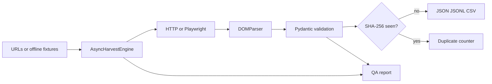

# dataharvest-qa

An offline-first Python 3.11 example for asynchronous web harvesting, DOM parsing, data normalization, and schema QA.

The repository uses `asyncio` and `httpx` for bounded concurrent fetches, `BeautifulSoup4` for DOM extraction, `Pydantic` v2 for validation, and optional Playwright Chromium contexts for JavaScript-rendered pages.

## Data flow



## Quick start

```powershell
python -m venv .venv
.\.venv\Scripts\Activate.ps1
pip install -r requirements.txt
python main.py --offline-demo
pytest
```

The demo writes `offline-demo.json`, `offline-demo.jsonl`, `offline-demo.csv`, and `offline-demo.qa.json` under `output/`. It does not require network access or a browser installation.

To enable the Playwright backend for live targets:

```powershell
playwright install chromium
python main.py --urls-file urls.txt --render-js --concurrency 6 --domain-delay 0.5
```

`urls.txt` contains one HTTP(S) URL per line. Blank lines and lines beginning with `#` are ignored. Static HTTP fetching is the default; `--render-js` opts every target into Chromium rendering.

## Package layout

```text
src/dataharvest/
  schemas.py      Strict Pydantic models and fingerprints
  parsers.py      HTML cleanup and structured extraction
  scraper.py      Async HTTP and Playwright fetch engine
  pipeline.py     Validation, deduplication, and exports
fixtures/         Offline HTML inputs
tests/            Parser and pipeline QA tests
main.py           CLI
```

## Design notes

- `CrawlTarget` rejects non-HTTP URLs and controls retry count and JavaScript rendering.
- Fetch concurrency is bounded by a semaphore. Requests to the same domain can be spaced with `--domain-delay`.
- Retries use exponential backoff for transport failures, HTTP 429, and HTTP 5xx responses.
- Boilerplate elements and common navigation markers are removed before text normalization.
- A document fingerprint is derived from normalized title, metadata, text, and tables. Duplicate documents are counted and excluded from exports.
- Each export is written to a temporary file in its destination directory and committed with `os.replace`.
- Invalid documents are excluded from exports and listed by field in the QA report.

## License

MIT. Add the license file and copyright holder details before publishing.
